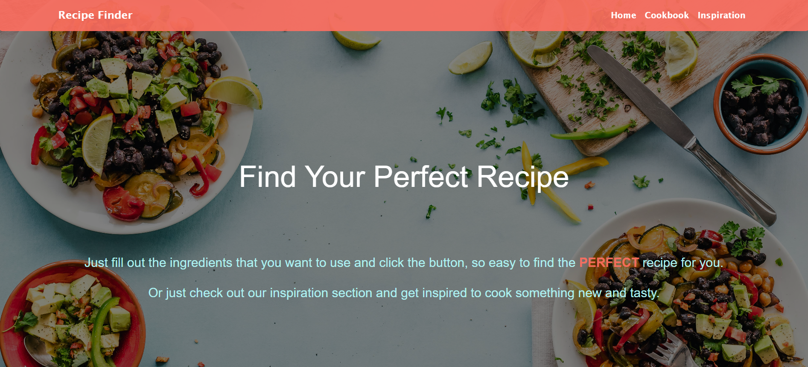
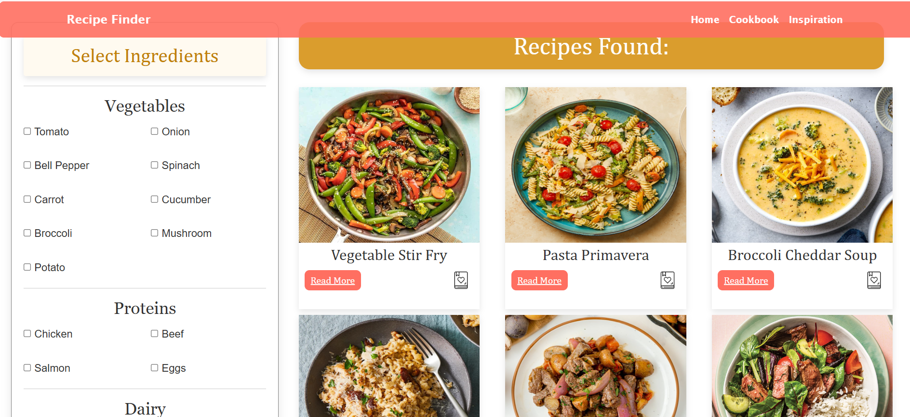
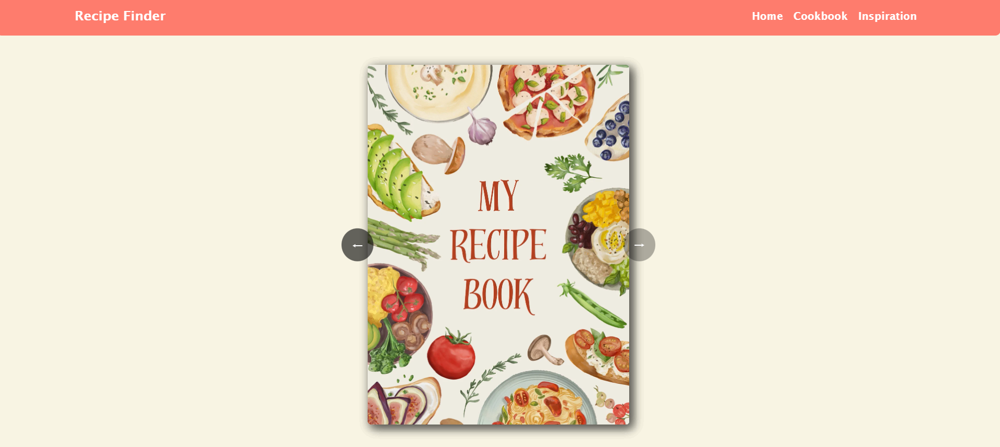
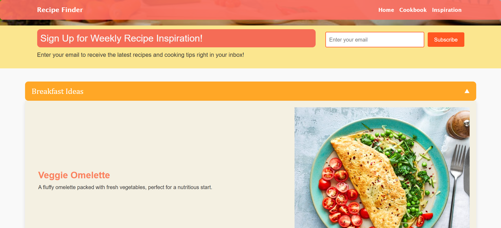

# Recipe Finder 🍽️

A web application that helps users decide what to cook based on the ingredients they already have. Search for recipes, read step-by-step instructions, save your favourites to a personal cookbook, and browse ideas for different meals.

> University web development coursework project.

## Screenshots

**Home page**



**Ingredient search and results**: select ingredients by category and browse matching recipes. Each card has a *Read More* button and a save-to-cookbook icon.



**Cookbook**: saved recipes presented as an interactive recipe book with page navigation.



**Inspiration**: meal ideas grouped into collapsible sections (e.g. Breakfast Ideas), plus a weekly newsletter sign-up form.



## Features

- **Ingredient-based search**: select ingredients from categorised checklists (Vegetables, Proteins, Dairy and more) and see matching recipes.
- **Recipe details**: view ingredients and preparation instructions for each recipe.
- **Cookbook**: save recipes with one click and flip through them in an interactive recipe-book view.
- **Inspiration page**: browse meal ideas in collapsible sections (breakfast and more), with an email sign-up form for weekly recipe ideas.
- **Visual design**: recipe photography and a custom, hand-written CSS layout (no CSS frameworks).

## Tech Stack

| Layer     | Technology                |
|-----------|---------------------------|
| Frontend  | HTML5, CSS3, JavaScript   |
| Backend   | PHP                       |
| Database  | MySQL / MariaDB           |
| Local env | WampServer (Apache + PHP) |

## Project Structure

```text
COURSEWORK/
├── index.php                 # Home page and ingredient-based search
├── recipe.php                # Recipe details page
├── cookbook.php              # Saved recipes (cookbook)
├── get_saved_recipes.php     # Server-side script returning saved recipes
├── inspiration.html          # Recipe inspiration page
├── screenshots/              # README screenshots (not part of the app)
├── style.css                 # Main styles
├── style_recipe.css          # Recipe page styles
├── style_book.css            # Cookbook page styles
├── style_inspiration.css     # Inspiration page styles
└── *.jpg / *.png / *.webp    # Recipe photos and UI images
```

## Getting Started

### Prerequisites

- [WampServer](https://www.wampserver.com/en/) (includes Apache, PHP and MySQL/MariaDB)
- A modern web browser

### Installation

1. **Start WampServer** and make sure all services are running (the tray icon is green).
2. **Copy the project** into WampServer's `www` directory, for example:
   ```text
   C:/wamp64/www/Recipe-Finder/
   ```
3. **Create the database:**
   1. Open phpMyAdmin at `http://localhost/phpmyadmin`.
   2. Create a database named `recipe_website`.
   3. Open the **Import** tab, select the project's `.sql` file and click **Go**.
4. **Configure the connection.** Open the PHP files that connect to the database (`index.php`, `recipe.php`, `cookbook.php`, `get_saved_recipes.php`) and make sure the host, database name, username and password match your local setup. A default WampServer installation typically uses user `root` with an empty password.
5. **Run the app** by opening `http://localhost/Recipe-Finder/` in your browser (use your actual folder name in the URL).

### Troubleshooting

- **Blank page or database error:** check that the `recipe_website` database exists and was imported successfully.
- **Images not loading:** make sure the image files are in the same folder as the PHP files.
- **Page not found:** confirm the folder name in `www` matches the URL.

## Security Note

Do not commit real database passwords to a public repository. For local development with default WampServer credentials this is fine, but for any deployed version, move credentials into a separate config file that is excluded via `.gitignore`.

## Future Improvements

- Smarter ingredient matching (partial matches, ranking by number of matched ingredients).
- Filters by category, preparation time and dietary preferences.
- User accounts, so each person has their own cookbook.
- Responsive layout and accessibility improvements.
- Centralised database configuration and a prepared-statements audit.
- Organise assets into `images/`, `css/` and `js/` folders.

## Author

**Yoana Andreeva**
GitHub: [@yoana-andreeva](https://github.com/yoana-andreeva)
